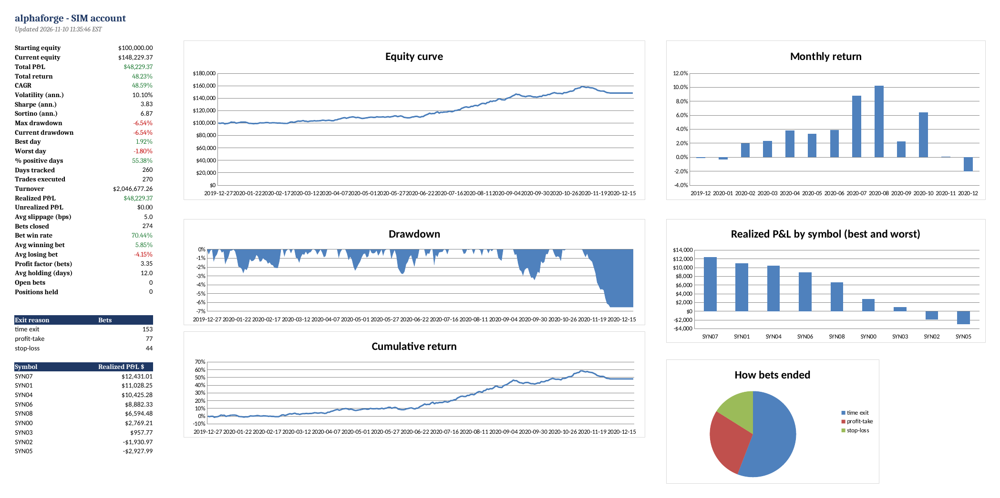

# alphaforge

A self-learning, alpha-discovering trading bot for US stocks and ETFs, built in Python on the Alpaca API. It searches
for trading signals, keeps only the ones that survive multiple-testing corrections, learns *when* to trust them with a
meta-labeling model, sizes and risk-budgets the bets, and retrains itself on a champion/challenger schedule while
learning from its own fills. Every order, fill and equity change lands in an auto-updating Excel log.

> **The source code is private** so that the signals and their parameters stay private. This repository documents the
> design, the research method and the output. Code walkthroughs are available on request.



*Dashboard sheet from one year of the bot's offline `demo` mode on **synthetic prices with a planted trend**
(`--signal 4`; `SYN00`–`SYN09` are fake tickers). It shows the live loop finding and trading a signal that is known to
exist, and what the Excel log records. It is not live, paper or backtested performance on real markets.*

---

## How it works

```
 weekly   SCAN every active US stock and ETF on Alpaca → exchange, price, liquidity and leverage filters → universe

 weekly   champion / challenger retrain
          1 DISCOVER  candidate signals, tested net of costs with the Deflated Sharpe Ratio, PBO and a holdout
          2 LABEL     CUSUM events + triple-barrier labels
          3 META-MODEL purged-CV random forest decides whether to act on a signal, and how much
          4 SHADOW    a challenger must beat the current champion out of sample before it gets capital

 daily    5 OPEN BETS     side from the signals, size from the meta-model
          6 PORTFOLIO     average active bets → hierarchical risk parity on a denoised covariance → vol target → caps
          7 EXECUTE       diff against positions → orders (sells first, cash-aware, idempotent order IDs)

 intraday 8 MONITOR       profit-take / stop-loss / expiry barriers, daily-loss and drawdown kill switches

 always   9 LEARN         retire signals whose live bets fail a PSR test, re-estimate costs from real fills,
                          force a retrain when features drift (PSI)
         10 LOG           every order, fill, bet and equity change written to Excel within seconds
```

## Research method: built to say "no alpha found"

Most backtested strategies are overfit. The bot is designed so that a signal has to clear several independent hurdles
before it trades:

1. **Net of costs, hedged against beta.** Each candidate is simulated as an equal-risk portfolio after trading costs,
   then hedged against a passive always-long book, so a filter that merely rides a rising market does not count as skill.
2. **Deflated Sharpe Ratio.** Is this Sharpe higher than the best of *K* useless strategies would reach by luck? *K* is
   the *effective* number of independent trials (clustered), because near-identical variants are not separate experiments.
3. **Probability of Backtest Overfitting (CSCV).** If the selection process itself overfits, nothing is accepted.
4. **Holdout and shadow trading.** A later holdout must confirm, and a new signal set must beat the champion over months
   of shadow trading before it gets capital.

On synthetic data the discovery step made **zero false discoveries in 64 runs** on pure-noise and drifting-market
series, while strong planted signals were found consistently. The test suite has 27 tests covering research,
execution and the Excel log.

| Component | Source |
|---|---|
| CUSUM event sampling | López de Prado, AFML ch. 2 |
| Triple-barrier labels, used as the live profit-take / stop / max-hold rules | AFML ch. 3 |
| Meta-labeling (signals pick the side, ML picks whether and how much) | AFML ch. 3.6 |
| Average-uniqueness sample weights | AFML ch. 4, 6 |
| Fractionally differentiated price features | AFML ch. 5 |
| Purged k-fold cross-validation with embargo | AFML ch. 7 |
| Clustered MDA feature importance and pruning | AFML ch. 8, MLAM ch. 6 |
| Bet sizing from predicted probability | AFML ch. 10 |
| Probability of Backtest Overfitting | AFML ch. 11 |
| Deflated Sharpe Ratio with effective number of trials | AFML ch. 14, MLAM ch. 8 |
| Hierarchical Risk Parity | AFML ch. 16 |
| Covariance denoising (Marčenko–Pastur) | MLAM ch. 2 |
| Costs charged on every trade and calibrated from fills | lesson from my [crypto size-premium study](https://github.com/NeillBotushanski/crypto-size-premium): premia that look real gross can vanish net |

## Engineering

- **Whole-market scan.** Weekly, the bot lists every active, tradable US stock and ETF on Alpaca (about 10,000 symbols),
  drops OTC names, warrants, units and leveraged / inverse / VIX products, applies price and dollar-volume floors, and
  trades the most liquid few hundred. Research is point-in-time: on each past date a stock only counts if it qualified
  *on that date*.
- **Execution.** Orders are diffed against current positions, sells go first, spending is cash-aware, and order IDs are
  idempotent so a rerun never doubles a trade. Holdings the bot never opened are never touched.
- **Risk.** Daily-loss and maximum-drawdown kill switches flatten and halt the bot; live trading is refused until the
  paper-trading record passes a gate. Long-only by default to fit a cash account and the pattern-day-trader rule.
- **Self-learning.** Champion/challenger retraining, retirement of signals that stop working live, cost re-estimation
  from real fills, and drift detection that forces an early retrain.
- **State.** A SQLite database is the source of truth, with a job ledger so scheduled runs are safe to repeat.
- **CLI.** `check`, `scan`, `discover`, `backtest`, `trade`, `monitor`, `run`, `status`, `report`, `halt` / `resume` /
  `flatten`, and an offline `demo` that runs the full live loop on synthetic data.

## Excel trade and performance log

The workbook is rebuilt a couple of seconds after every order, fill, bet open/close and equity update, in a background
thread so trading is never delayed. The workbook from the planted-trend demo run above is in
[`sample_output/`](sample_output/alphaforge_sample_log_SIMULATED.xlsx) (signal names redacted).

| Sheet | Contents |
|---|---|
| Dashboard | Equity, P&L, return, CAGR, Sharpe, Sortino, drawdown, win rate, profit factor, slippage, open bets; charts of the equity curve, drawdown, cumulative return, monthly returns, P&L by symbol and how bets ended |
| Daily | One row per day: equity, P&L, returns, drawdown, trades, turnover, realized P&L, bets opened / closed / won, with charts |
| Weekly / Monthly / Quarterly / Yearly | Period P&L, return, trades, turnover, win rate, average bet return, best / worst day, max drawdown, volatility, Sharpe, with charts |
| Trades | Every order the moment it is sent: decision price, fill price, notional, slippage, realized P&L, status, reason |
| Bets | Every signal-level bet: meta-model probability, entry, take-profit, stop-loss, expiry, exit, exit reason, return, holding days |
| Positions | Current holdings with average cost, market value, unrealized P&L and weight |
| Strategy History | Every retrain: champion vs challenger shadow Sharpe and meta-model AUC |

## Stack

Python · pandas · NumPy · SciPy · scikit-learn · statsmodels · alpaca-py · openpyxl · SQLite · pytest

## References

- M. López de Prado, *Advances in Financial Machine Learning* (2018)
- M. López de Prado, *Machine Learning for Asset Managers* (2020)
- D. Bailey & M. López de Prado, "The Deflated Sharpe Ratio" (2014)
- D. Bailey, J. Borwein, M. López de Prado & Q. Zhu, "The Probability of Backtest Overfitting" (2017)

---

*Nothing here is financial advice. Live trading is gated behind the bot's own paper-trading record.*
